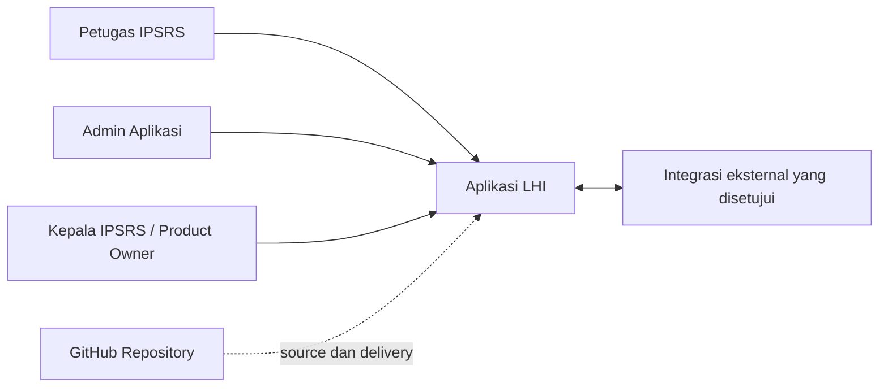
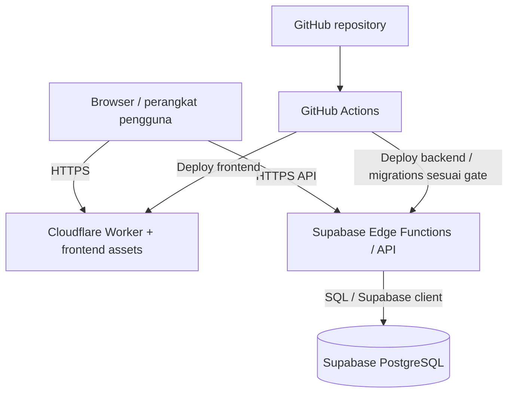

# SOFTWARE ARCHITECTURE DOCUMENT — APLIKASI LHI

## 1. Tujuan dan status

Dokumen ini memisahkan arsitektur existing yang teridentifikasi dari arsitektur target. Snapshot source bukan verifikasi runtime. Diagram dan daftar komponen harus diperbarui setelah audit repository/platform dan perubahan arsitektur.

## 2. Prinsip arsitektur

- GitHub repository adalah sumber kode utama.
- GitHub Actions menjalankan audit, regression gate, dan deployment sesuai workflow.
- Cloudflare Worker menyajikan frontend.
- Supabase Edge Functions menjadi backend/API.
- Supabase PostgreSQL menjadi database aktif yang didokumentasikan.
- Frontend bukan boundary otorisasi; backend wajib memeriksa akses.
- Data ownership, API contract, dan dependency harus eksplisit.
- Modular monolith adalah pilihan awal yang dapat dipelihara; microservices bukan default.
- Penambahan modul dilakukan bertahap tanpa harus membangun semua modul sekaligus.
- Modul LOCKED dan perilakunya tetap dilindungi.

## 3. Context diagram (C4 Level 1)

Integrasi eksternal pada diagram adalah kemungkinan arsitektural, bukan klaim bahwa integrasi telah tersedia. Setiap integrasi memerlukan kontrak dan persetujuan.

## 4. Container diagram (C4 Level 2)

Koneksi aktual, environment, secrets, CORS, cache, dan deployment harus diverifikasi terhadap konfigurasi runtime. Diagram ini merupakan model dokumentasi tingkat tinggi.

## 5. Deployment dan environment

Wajib ada inventaris untuk:
- development/local;
- staging/test;
- production;
- Cloudflare Worker dan asset binding;
- Supabase project, Edge Functions, database, migrations;
- GitHub Actions environments, permissions, secrets;
- domain, TLS, CORS, headers, cache;
- backup dan restore target.

Pemisahan environment harus menggunakan credential dan data yang berbeda. Bila staging belum tersedia, gap dan mitigasi harus dicatat; jangan menyebut staging ada tanpa bukti.

## 6. Component boundaries

Target domain boundaries:
- AUTH/ACCESS: identity, session, role, permission.
- REPORT/INPUT: lifecycle laporan dan validasi.
- MASTER/KAT: area, item, kategori, master data.
- SPARE_MATERIAL_UNIT: klasifikasi komponen/material/unit.
- DASH/REKAP: read models dan agregasi operasional.
- MONITORING: status dan aktivitas petugas.
- AUDIT_LOG: histori dan jejak tindakan.
- PWA: asset lifecycle dan cache.
- PLATFORM/SECURITY: API, RLS, secret, logging, runtime.
- CICD: audit, test, artifact, deployment.

Ini adalah batas domain target. Implementasi saat ini masih memiliki shared files dan handler terpusat; tidak boleh menganggap pemisahan fisik telah selesai.

## 7. Data flow dan trust boundary

Alur utama:
1. Pengguna membuka frontend melalui HTTPS.
2. Frontend meminta data/aksi ke API dengan kredensial sesi yang berlaku.
3. API memverifikasi autentikasi, role, permission, dan validasi bisnis.
4. API membaca/menulis database melalui kredensial server-side yang sesuai.
5. Hasil dikembalikan dengan field yang diizinkan.
6. Peristiwa penting dicatat ke audit log sesuai kebijakan.

Trust boundary:
- perangkat pengguna tidak dipercaya;
- frontend/browser tidak boleh menjadi sumber otorisasi;
- API adalah boundary enforcement;
- database RLS/privilege menjadi defense in depth;
- pipeline deployment dan secret store merupakan boundary administratif kritis.

## 8. Architecture Decision Records (ADR)

Keputusan material harus memiliki ADR dengan:
- ID, tanggal, status, owner;
- konteks dan masalah;
- pilihan yang dipertimbangkan;
- keputusan dan alasan;
- konsekuensi positif/negatif;
- risiko, mitigasi, dan rollback;
- dependency serta requirement terkait.

ADR diperlukan untuk keputusan seperti pemilihan platform, pola autentikasi, database, module boundary, caching, API versioning, dan migrasi. Keputusan yang sudah digantikan tetap disimpan sebagai SUPERSEDED, bukan dihapus.

## 9. API dan database architecture

- API contract menggunakan dokumentasi terstruktur (OpenAPI untuk HTTP yang sesuai).
- Endpoint inventory mencatat method, auth, permission, input/output, error, pagination, rate limit, dan konsumen.
- ERD dan data dictionary mencatat ownership, constraints, indexes, RLS, triggers, dan retention.
- Database migration harus backward compatible bila memungkinkan, diuji, direview, dan memiliki restore/rollback plan.
- Frontend tidak boleh menyimpan service-role secret atau melewati API untuk operasi sensitif.

## 10. Security architecture

Security architecture mengikuti Security Assurance Plan dan threat model. Setiap data flow harus menandai klasifikasi data, autentikasi, otorisasi, enkripsi, logging, retention, dan trust boundary. RLS tidak menggantikan authorization review pada API; UI hiding tidak menggantikan kontrol server.

## 11. Reliability dan observability

Setiap container dan alur kritis memiliki health/availability signal, structured logs, error metrics, alert owner, runbook, dan recovery procedure. SLI/SLO ditetapkan setelah baseline pengukuran. Log wajib menghindari secret dan data pribadi yang tidak diperlukan.

## 12. Kapasitas dan performance architecture

Kinerja diukur pada browser, Worker, Edge Function, query database, dan network. Baseline p50/p95/p99, throughput, error rate, concurrency, dan resource utilization harus dikumpulkan. Optimasi mengikuti hasil pengukuran, bukan asumsi.

## 13. Risiko arsitektur

- Shared frontend/backend code memperbesar blast radius.
- Ketiadaan staging yang representatif meningkatkan risiko release.
- API/DB contract yang belum lengkap dapat memicu breaking changes.
- RLS dan role mapping yang tidak diuji dapat membuka akses lintas pengguna.
- Cache/PWA dapat menayangkan asset tidak konsisten.
- Backup yang belum diuji dapat gagal saat recovery.
- Integrasi vendor menambah dependency, biaya, dan risiko data.

Setiap risiko harus masuk risk register dengan likelihood, impact, owner, mitigasi, residual risk, dan due date.

## 14. Verifikasi arsitektur

Arsitektur dianggap sesuai bila:
- diagram cocok dengan source dan runtime;
- API/data inventory tersedia;
- trust boundary dan security control diuji;
- modul dan dependency map terverifikasi;
- deployment SHA parity terbukti;
- backup/restore dan rollback diuji;
- SLO dan monitoring tersedia.

## 15. Temuan verifikasi source — notifikasi disiplin LHI

Snapshot source `main` yang diperiksa 16 November 2026 menunjukkan alur peringatan disiplin belum membentuk satu jalur end-to-end:
- `frontend/login-fast.js` memanggil `apiGetDisciplineWarning`, lalu hanya menampilkan nama dengan `missed_days >= 9`.
- Database PostgreSQL memiliki `run_lhi_discipline_scheduler()` yang dijalankan cron aktif setiap 5 menit. Scheduler menghasilkan event `DAY_4`, `DAY_6`, dan `DAY_7` ke `lhi_discipline_notifications`; database produksi menunjukkan 521 row `DAY_4` dari 18 event. Namun Edge Function `ipsrs-api` aktif v114 belum memiliki action inbox/read yang dipanggil frontend.
- Action lama `apiGetDisciplineWarning` hanya mengembalikan `staff_id` dan `nama`; frontend `login-fast.js` mengharapkan `missed_days >= 9`, sehingga jalur modal lama juga tidak cocok.
- `frontend/lhi-discipline-notifications.js` meminta `apiGetLhiNotifications` dan menandai baca melalui `apiMarkLhiNotificationRead`; kedua action tersebut tidak ditemukan pada inventory action backend `ipsrs-api/index.ts` yang diperiksa.
- Backend gate login menghitung tujuh tanggal sebelumnya dari kolom `reports.tanggal` dan melakukan blokir saat tujuh tanggal itu kosong. Ini berbeda dari acuan README Form Blok yang menetapkan `created_at` dikonversi ke WIB dan menghitung tanggal kalender penuh tanpa input.

**Implikasi arsitektur:** event generation dan persistence server-side sudah ada; yang terputus adalah API inbox/read antara frontend dan tabel notifikasi. Frontend tidak boleh menghitung sendiri atau membaca tabel secara langsung. PR #77 menambahkan API terautentikasi yang membatasi pembacaan/penandaan ke `recipient_staff_id` milik sesi.

**Status:** DATABASE SCHEDULER + DAY_4 PERSISTENCE VERIFIED IN PRODUCTION; INBOX API MISSING IN ACTIVE EDGE FUNCTION v114; API FIX ADDED TO PR #77, NOT DEPLOYED. Tidak ada perubahan runtime produksi. Perbaikan inbox PR #77 dan Form Blok/Recovery PR #76 adalah dua change set terpisah; masing-masing wajib lulus gate dan deployment approval sebelum production.

## 16. Form Blok/Recovery architecture status — 16 November 2026

Arsitektur Form Blok/Recovery pada branch PR #76 memisahkan tanggung jawab sebagai berikut:
- Frontend hanya memulai pemeriksaan status blokir dan menampilkan Form Blok; frontend tidak menentukan hari disiplin atau mengubah global lock.
- lhi-reset-verify memverifikasi kode Reset dan menerbitkan one-time challenge dengan rate limit server-side.
- lhi-recovery-exchange memvalidasi sesi Supabase KA IPSRS dan menukar challenge menjadi recovery capability terbatas.
- lhi-recovery-action memvalidasi capability melalui database RPC untuk membaca status recovery atau memulai grace 120 jam.
- lhi-block-status membaca global lock dan snapshot kewajiban; hanya kewajiban yang belum selesai dari petugas yang masih Aktif ditampilkan sebagai pemicu.
- PostgreSQL menjadi otoritas state machine, scheduler, perhitungan WIB, snapshot, idempotency, dan audit.

Branch PR #76 lulus full automated regression gate 43835446297 (static, Deno, PostgreSQL, browser 20/20). Production belum mengikuti migration alignment; open_lhi_global_grace_v2 production masih SAFE_CUTOVER_REQUIRED dan incident GRACE aktif sampai 19 November 2026 pukul 18.17 WIB. Arsitektur branch tidak boleh disamakan dengan as-built production.

## 17. Riwayat

| Tanggal | Perubahan |
|---|---|
| 15 November 2026 | Baseline awal arsitektur existing dan target |
